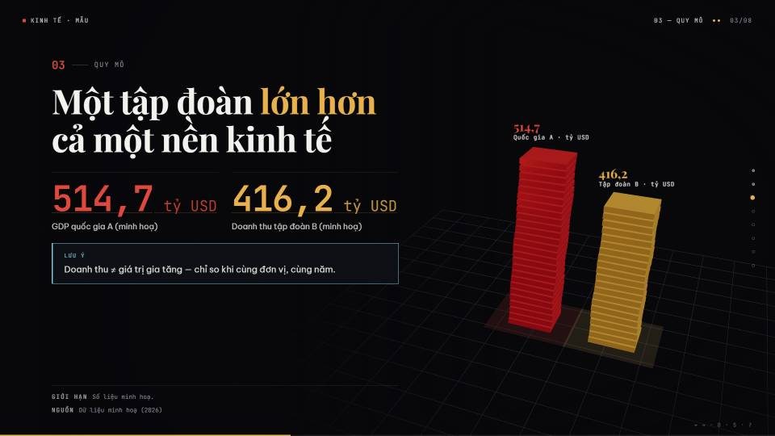
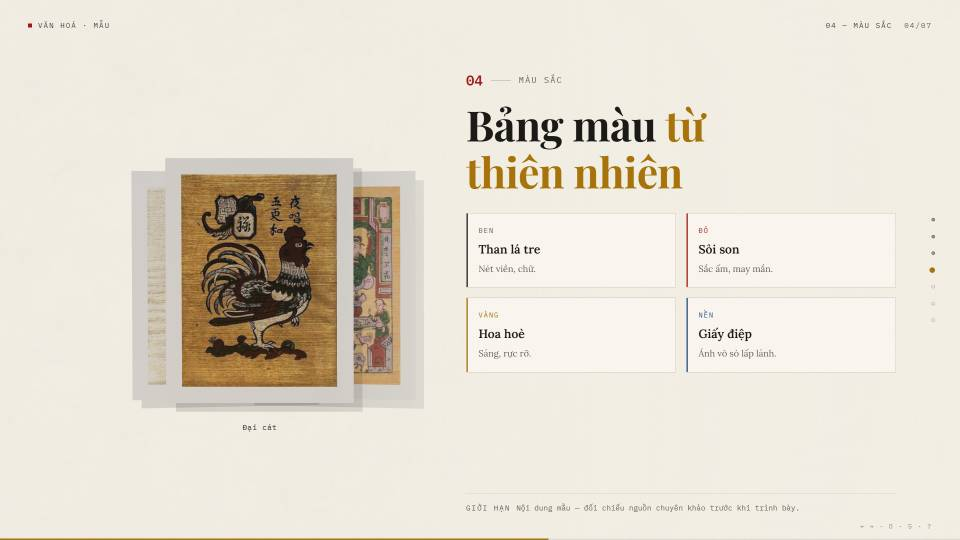
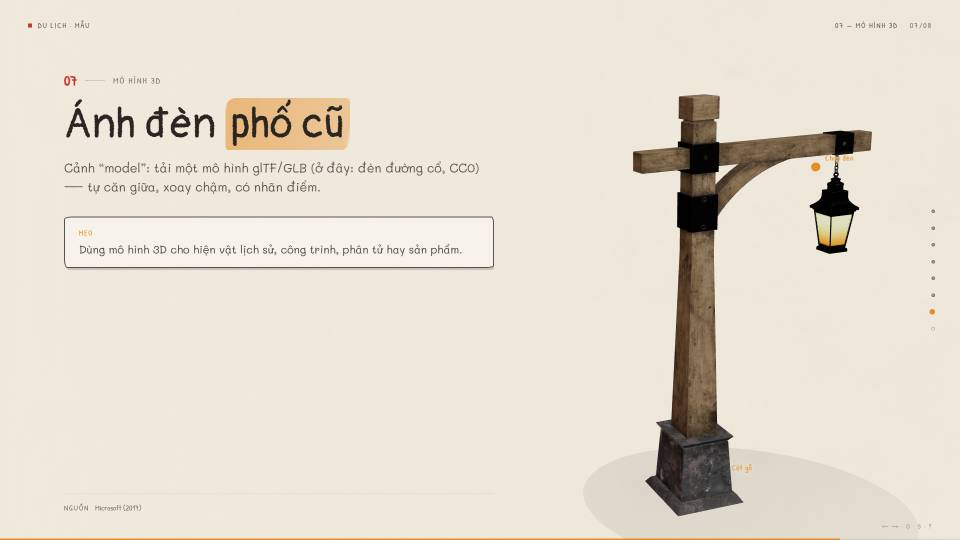
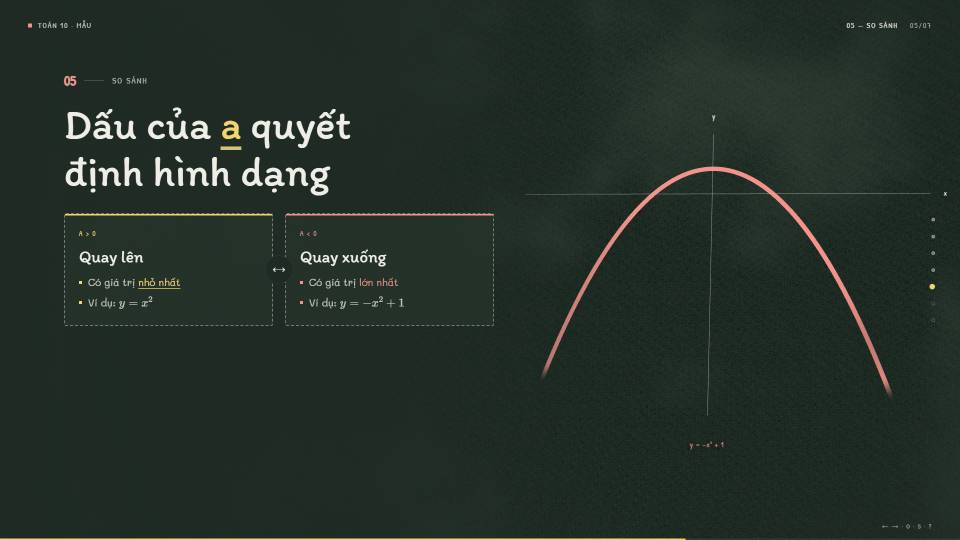
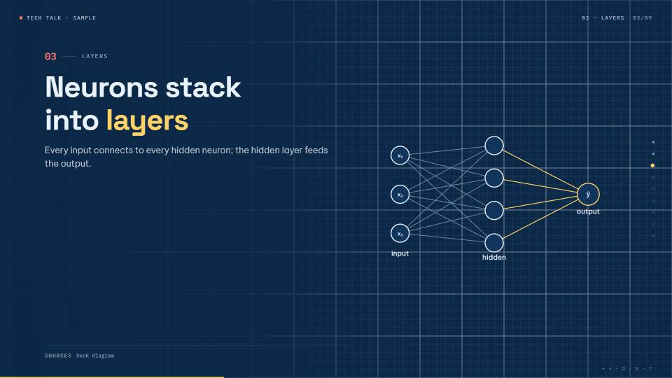

# Interactive 3D Presentation — Agent Skill

Skill giúp AI agent (Claude Code, Codex, Antigravity, Cursor…) dựng **bài thuyết trình web 16:9 có tương tác 3D** cho
mọi chủ đề: kinh tế, chính trị, lịch sử, địa lí, du lịch, văn học, nghệ thuật, khoa học, toán, CNTT, kinh doanh/pitch.
Đầu vào là file nội dung (+ kịch bản nếu có). Agent hỏi bạn muốn sản phẩm thế nào, dựng deck, tự tìm ảnh có nguồn, kiểm
tra bằng ảnh chụp rồi bàn giao.

> *English quick start ở [cuối trang](#english-quick-start).*

| | | |
|---|---|---|
|  |  |  |
| Cột 3D theo số liệu | Hành trình trên địa cầu | Tranh/ảnh thật trong không gian 3D |
|  |  |  |
| Mô hình 3D + camera theo kịch bản | Đồ thị hàm số 3D | Sơ đồ SVG tự vẽ nét |

## Tính năng
- **3D mang nội dung, không trang trí**: 15 cảnh (cột số liệu, địa cầu tuyến đường, mạng lưới, quy trình, dòng thời
  gian, đồ thị toán, tường tranh, parallax, mô hình glTF, giấy tờ 3D, bánh răng, hạt biến hình, ThreeUI, Spline). Mỗi cảnh phải
  kèm một câu giải thích nó minh hoạ điều gì; mỗi slide chỉ một hình chính để không rối mắt.
- **23 block**: số liệu đếm lên, biểu đồ, lưới ô, vòng đo, đường kích thước, mô phỏng kéo thả, bảng, so sánh, bento,
  timeline, quy trình, trích dẫn, ảnh, gallery, video (YouTube), sơ đồ SVG, Lottie, code tô màu, công thức KaTeX…
- **Bộ hiệu ứng "bản vẽ kỹ thuật" 2D**: bút khoanh/gạch/mũi tên theo nhịp, đường nối có hạt chạy, thẻ mở phần, chuyển cảnh
  lau, nét tự vẽ, số đếm giữ định dạng, con dấu, máy đánh chữ.
- **8 theme** (+ phím D đổi sáng/tối khi trình chiếu): tối sang trọng, giấy ngà học thuật, bảng trắng, bảng phấn, sổ vẽ tay,
  bản vẽ kỹ thuật nền xanh, bản vẽ trên giấy can, neon.
- **Trình chiếu thật**: click / phím / con lăn / bút trình chiếu đi từng nhịp; cửa sổ người nói; ghi chú; đồng hồ;
  số liệu bấm ra nguồn (APA); chế độ giảm chuyển động; chạy offline; bản landing page cuộn mượt.
- **Tiếng Việt và English** (giao diện + định dạng số), font có đủ dấu.
- **Công cụ kiểm tra**: validator nội dung (nguồn, miền cấm, màu cứng, chỗ giữ chỗ…), QA chụp ảnh mọi slide bằng Chrome/Edge
  (báo tràn chữ, đè chữ, lỗi), sinh kịch bản nói theo người nói, tìm ảnh Wikimedia, tải asset về máy, **một file HTML
  chạy offline**, **CI GitHub Actions**.
- **Quy trình làm bài có AI**: agent hỏi brief, phản biện thay vì chiều lòng, bảng kiểm chứng số liệu, phụ lục khai báo AI,
  câu hỏi phản biện 3C, quiz, nhật ký bàn giao giữa các phiên chat.
- Engine: React 19 · TypeScript · Tailwind CSS v4 · React-Three-Fiber · GSAP · Theatre.js · Lenis · Lottie · Spline.

## Yêu cầu
- [Node.js](https://nodejs.org) **≥ 20.19** (hoặc ≥ 22.12) — để chạy deck agent tạo ra.
- Git (để tải repo) · Chrome hoặc Edge (để agent chạy QA ảnh chụp).
- Một AI agent hỗ trợ Agent Skills (`SKILL.md`): Claude Code, Codex, Antigravity, Cursor, Windsurf, Cline, OpenCode…

## Cài đặt

### Cách 1 — Script cài đặt (khuyên dùng)
```bash
git clone https://github.com/phuc220204/interactive-3d-presentation-skill.git
cd interactive-3d-presentation-skill
```
Windows (PowerShell):
```powershell
.\install.ps1                      # cài toàn cục cho Claude Code + Codex + Antigravity
.\install.ps1 -Agent claude        # chỉ một agent: claude | codex | antigravity
.\install.ps1 -Project D:\my-deck  # chỉ cài vào một dự án
```
Nếu PowerShell chặn script: `powershell -ExecutionPolicy Bypass -File .\install.ps1`

macOS / Linux / Git Bash:
```bash
./install.sh                       # toàn cục cho Claude Code + Codex + Antigravity
./install.sh --agent codex         # claude | codex | antigravity | all
./install.sh --project ~/my-deck   # chỉ cài vào một dự án
```

### Cách 2 — `npx skills` (nhiều agent, kể cả Cursor/Windsurf/Cline)
```bash
npx skills add phuc220204/interactive-3d-presentation-skill               # chọn agent trong danh sách
npx skills add phuc220204/interactive-3d-presentation-skill -g -a claude-code -a codex   # cài toàn cục cho agent chỉ định
```
(Dùng [Vercel skills CLI](https://github.com/vercel-labs/skills); tắt thống kê ẩn danh bằng `DISABLE_TELEMETRY=1`.)

### Cách 3 — Copy tay
Copy nguyên thư mục [`skills/interactive-3d-presentation`](skills/interactive-3d-presentation) vào:

| Agent | Toàn cục (mọi dự án) | Chỉ một dự án |
|---|---|---|
| Claude Code | `~/.claude/skills/interactive-3d-presentation/` | `<dự án>/.claude/skills/interactive-3d-presentation/` |
| Codex | `~/.agents/skills/interactive-3d-presentation/` | `<dự án>/.agents/skills/interactive-3d-presentation/` |
| Antigravity | `~/.gemini/config/skills/interactive-3d-presentation/` (bản cũ: `~/.gemini/antigravity/skills/`) | `<dự án>/.agents/skills/interactive-3d-presentation/` |
| Agent khác | theo tài liệu agent (thư mục skills) | — |

`~` là thư mục người dùng (Windows: `C:\Users\<tên>`). Khởi động lại agent sau khi cài.

### Agent chưa hỗ trợ skill
Clone repo rồi nói với agent: *"Đọc `skills/interactive-3d-presentation/SKILL.md` và làm theo quy trình trong đó"*
(file [`AGENTS.md`](AGENTS.md) ở gốc repo cũng chỉ dẫn điều này).

## Sử dụng
1. Chuẩn bị nội dung (khuyên dùng): `noi-dung.md` (ý từng slide, số liệu, ảnh nếu có) và `kich-ban.md` (lời nói).
   Chia slide bằng `## Slide 1: Tiêu đề` hoặc `---`. Không có file? Cứ mô tả chủ đề, agent sẽ soạn dàn ý cho bạn duyệt.
2. Mở agent trong một thư mục trống và yêu cầu, ví dụ:
   ```text
   Tạo slide 3D tương tác về "Hội An — phố cổ bên dòng Hoài" từ noi-dung.md và kich-ban.md, thuyết trình 10 phút.
   ```
   ```text
   Làm bài thuyết trình web có 3D cho môn Kinh tế chính trị, chủ đề tập đoàn xuyên quốc gia, theme tối, có số liệu và nguồn.
   ```
3. Agent sẽ **hỏi brief** trước khi làm (theme, font, màu, loại ảnh, model 3D, mức hiệu ứng, cách bấm, offline…) — mỗi
   câu có đề xuất sẵn, bạn chỉ cần đồng ý hoặc sửa. Muốn xem các hiệu ứng để chọn: bảo agent mở
   [`references/effects-catalog.md`](skills/interactive-3d-presentation/references/effects-catalog.md) (có ảnh xem trước).
4. Agent dựng deck → tìm ảnh có nguồn → kiểm tra (validate + chụp ảnh từng slide) → bàn giao kèm cách chạy.
5. Chạy deck agent tạo ra:
   ```bash
   npm run dev       # mở http://localhost:5173
   npm run build     # bản tĩnh trong dist/ — deploy lên Vercel, Netlify, GitHub Pages
   npm run build:single   # một file dist-single/index.html — mở bằng double-click, không cần mạng
   ```

**Phím khi trình chiếu:** → / Space / click / bút trình chiếu = tiếp · ← / Shift+click / chuột phải = lùi · con lăn
· S ghi chú · P cửa sổ người nói · K soi nguồn · D sáng/tối · O tổng quan · F toàn màn hình · T bấm giờ · ? trợ giúp.

### Thử ngay không cần agent
```bash
cp -r skills/interactive-3d-presentation/template ./thu-deck      # PowerShell: Copy-Item -Recurse skills\interactive-3d-presentation\template .\thu-deck
cd thu-deck
npm install
npm run use-example -- travel-hoi-an   # hoặc: economics-vi, tech-talk-en, history-art, science-lesson, business-pitch-en, drafting-lesson
npm run dev
```

## Cập nhật / gỡ
- Cập nhật: `git pull` rồi chạy lại script cài đặt (ghi đè bản cũ).
- Gỡ: xoá thư mục `interactive-3d-presentation` trong thư mục skills của agent (bảng ở Cách 3).

## Cấu trúc repo
```
install.ps1 · install.sh          script cài đặt
AGENTS.md                         chỉ dẫn cho agent chưa hỗ trợ skill
skills/interactive-3d-presentation/
  SKILL.md                        quy trình 10 bước + luật cứng (agent đọc file này)
  references/                     21 tài liệu: hỏi brief, luật thiết kế, schema, layout, cảnh 3D, catalog hiệu ứng,
                                  chủ đề, asset, thư viện, theme, chuyển động, trình chiếu, QA, cảm hứng, AI phản biện
                                  + prompt mẫu, kiểm chứng nguồn, phụ lục AI, hỏi đáp 3C/quiz, quy trình làm việc, nộp bài
  template/                       dự án React dựng sẵn (engine + 8 deck ví dụ + công cụ + docs/ mẫu + CI)
```
Tài liệu skill viết bằng tiếng Việt; tên trường, mã nguồn bằng tiếng Anh.

## Giấy phép
[MIT](LICENSE) cho skill và template. Thư viện, font và asset bên thứ ba giữ giấy phép riêng — xem
[`THIRD_PARTY_NOTICES.md`](skills/interactive-3d-presentation/template/THIRD_PARTY_NOTICES.md). Ảnh trong các deck ví dụ
lấy từ Wikimedia Commons, tác giả và giấy phép ghi trong `sources.ts` của từng ví dụ.

---

## English quick start
An agent skill that lets Claude Code, Codex, Antigravity, Cursor and other agents build **interactive 3D web
presentations** (16:9 decks or smooth-scroll landing pages) on any topic: React 19, Tailwind v4, React-Three-Fiber,
GSAP. It ships 14 data-driven 3D scenes, 19 content blocks, 7 themes, step-by-step reveals (click, keys, wheel,
clicker), a presenter view, clickable citations, offline mode and screenshot QA. Skill docs are in Vietnamese, but
agents follow them fine; the deck UI supports `lang: 'en'`.

**Install** (requires Node.js ≥ 20.19):
```bash
git clone https://github.com/phuc220204/interactive-3d-presentation-skill.git && cd interactive-3d-presentation-skill
./install.sh                 # macOS/Linux — or on Windows: .\install.ps1
# or: npx skills add phuc220204/interactive-3d-presentation-skill
```
Manual install: copy `skills/interactive-3d-presentation` to `~/.claude/skills/` (Claude Code), `~/.agents/skills/` (Codex),
or `~/.gemini/config/skills/` (Antigravity).

**Use:** in an empty folder, ask your agent
*"Create an interactive 3D presentation about <topic> from content.md and script.md, 10 minutes, in English."*
The agent asks a short brief (theme, fonts, imagery, 3D models, effects, offline), builds the deck, finds credited
images, runs QA and hands over. Run the deck with `npm run dev`; build with `npm run build`.
Try it without an agent: copy `skills/interactive-3d-presentation/template`, `npm install`, `npm run use-example -- tech-talk-en`, `npm run dev`.

License: MIT (third-party components keep their own licenses).
